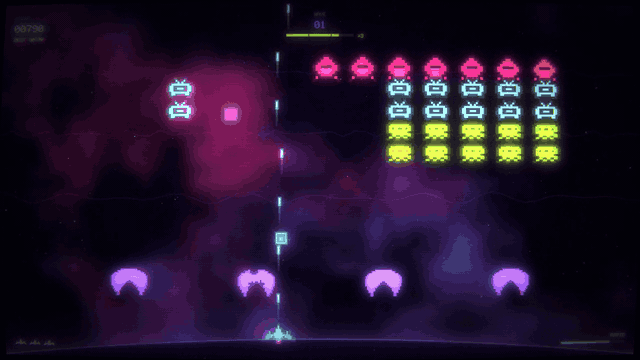
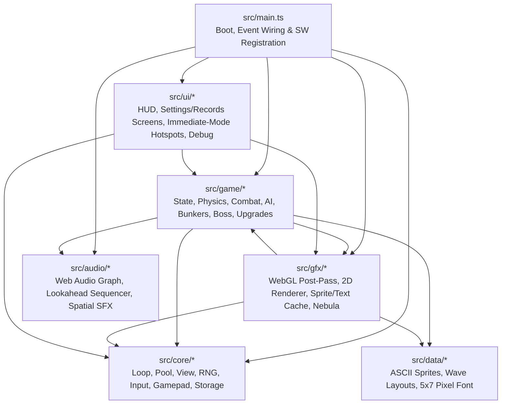
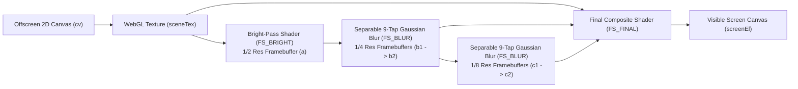
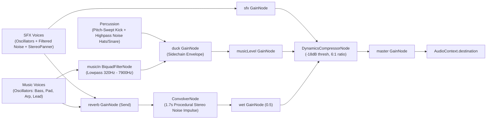

# Signal Lost

> *"They came down through the carrier wave."*

Made by [Mike Higgins](https://mikehiggins.me.uk/)

**Signal Lost** is a zero-runtime-dependency, procedural arcade space shooter written in strict TypeScript. Everything — pixel-art sprites, glowing bitmap fonts, procedural FBM nebulae, destructible shield pylons, multi-pass WebGL CRT/bloom shaders, and an adaptive 16-step Web Audio synthesizer/sequencer — is generated programmatically at runtime with **zero external image, font, or audio assets**.

---

## Gameplay Demo



---

## Table of Contents

1. [Technical Highlights](#technical-highlights)
2. [Architecture & Module Graph](#architecture--module-graph)
3. [Core Engine Subsystems](#core-engine-subsystems)
   - [Fixed-Timestep Simulation & Motion Interpolation](#1-fixed-timestep-simulation--motion-interpolation)
   - [Zero-Allocation Object Pooling](#2-zero-allocation-object-pooling)
   - [Adaptive Virtual Coordinate Space](#3-adaptive-virtual-coordinate-space)
   - [Deterministic PRNG & Daily Runs](#4-deterministic-prng--daily-runs)
   - [Unified Tri-Modal Input Pipeline](#5-unified-tri-modal-input-pipeline)
4. [Graphics & Post-Processing Pipeline](#graphics--post-processing-pipeline)
   - [Dual-Canvas Architecture & WebGL Shader Pipeline](#1-dual-canvas-architecture--webgl-shader-pipeline)
   - [Procedural Assets: Sprites, Text Cache & FBM Nebula](#2-procedural-assets-sprites-text-cache--fbm-nebula)
   - [Dynamic Theme Adaptation & Accessibility](#3-dynamic-theme-adaptation--accessibility)
5. [Procedural Web Audio Synthesizer & Sequencer](#procedural-web-audio-synthesizer--sequencer)
   - [Signal Routing Graph](#1-signal-routing-graph)
   - [Lookahead Step Sequencer & Adaptive Arrangement](#2-lookahead-step-sequencer--adaptive-arrangement)
   - [Spatialized Sound Effects](#3-spatialized-sound-effects)
6. [Gameplay Mechanics & Combat Physics](#gameplay-mechanics--combat-physics)
   - [Swept Collision Detection & Destructible Bunkers](#1-swept-collision-detection--destructible-bunkers)
   - [Enemy Roster, Ballistics & Formation Dynamics](#2-enemy-roster-ballistics--formation-dynamics)
   - [Boss Encounters: The Carrier](#3-boss-encounters-the-carrier)
   - [Signal Meter, Graze Detection & Pulse Discharges](#4-signal-meter-graze-detection--pulse-discharges)
   - [Weapons, Upgrades & Achievements](#5-weapons-upgrades--achievements)
7. [Progressive Web App (PWA) & Offline Support](#progressive-web-app-pwa--offline-support)
8. [Getting Started & Development](#getting-started--development)
   - [Console Debugging Hooks](#console-debugging-hooks)

---

## Technical Highlights

- **Zero Runtime Dependencies**: Pure TypeScript compiled via Vite (`typescript`, `vite`, `vitest`, `happy-dom` as `devDependencies` only).
- **100% Procedural Asset Generation**:
  - **Graphics**: Sprites and destructible bunker masks are compiled from ASCII bitmaps (`src/data/sprites.ts`); text uses a custom 5×7 pixel font (`src/data/font.ts`) pre-rasterized with baked `shadowBlur` into an LRU-style canvas cache (`src/gfx/text.ts`).
  - **Audio**: Real-time Web Audio API synthesis (`OscillatorNode`, `BiquadFilterNode`, `ConvolverNode` with procedurally generated stereo impulse response, `DynamicsCompressorNode`, and `StereoPannerNode`).
- **120 Hz Fixed-Timestep Physics with Sub-Frame Extrapolation**: Simulation steps deterministically at `STEP = 1 / 120` s (~8.33 ms), while `render(ahead)` extrapolates entity positions along their velocity vectors by the unconsumed accumulator fraction for smooth motion on 60 Hz, 120 Hz, or 144 Hz+ monitors.
- **Multi-Pass WebGL Post-Processing (`src/gfx/post.ts`)**:
  - 2×2 box downsample bright-pass filter.
  - Two-level separable 9-tap Gaussian blur (via 5 bilinear hardware samples per pass) across half-, quarter-, and eighth-resolution framebuffers.
  - Final composite shader featuring barrel CRT curvature, radial + glitch chromatic aberration, up to 4 concurrent screen-space refractive shockwaves, scanline modulation, vignette, film grain, and row-tearing glitch distortion.
  - Automatic graceful fallback to Canvas 2D + CSS GPU-composited scanline/vignette layers when WebGL is unavailable.

---

## Architecture & Module Graph

The codebase is organized into six strictly separated layers under `src/` to prevent circular dependencies:



### Directory Breakdown

| Directory | File | Responsibility |
| :--- | :--- | :--- |
| **`src/core/`** | `loop.ts` | Fixed-timestep `1/120` s accumulator loop with `MAX_FRAME = 0.1` s spiral-of-death clamp |
| | `pool.ts` | Generic $O(1)$ swap-on-kill object pool (`Pool<T>`) eliminating GC pressure during gameplay |
| | `view.ts` | Dual-canvas setup (`cv` offscreen 2D, `screenEl` visible WebGL/2D) and responsive aspect scaling |
| | `rng.ts` | Seeded `mulberry32` PRNG (`sr`, `srand`, `srandi`, `spick`) isolating gameplay determinism from cosmetic randomness |
| | `input.ts` | Unified keyboard, pointer/touch steering, key rebinding capture, and focus management |
| | `gamepad.ts` | W3C Standard Gamepad polling with deadzone filtering and rising-edge button detection |
| | `storage.ts` | Fault-tolerant `localStorage` persistence under `signal-lost:v1` with schema sanitization |
| | `math.ts` | Fast scalar helpers (`clamp`, `lerp`, `rand`, `randi`, `pick`) |
| **`src/data/`** | `sprites.ts` | ASCII bitmap definitions for all 7 enemy classes, boss, ship, relay, bombs, and 22×16 bunker mask |
| | `waves.ts` | 11×5 formation layouts, enemy type codes (`WRCBSLN`), and boss wave cadence (every 5th wave) |
| | `font.ts` | 5×7 pixel glyph bitmaps compiled into flat `(x, y)` coordinate arrays at load time |
| **`src/game/`** | `state.ts` | Centralized mutable state store (`G`, `fx`, `player`, `boss`, `form`, `enemies`, entity pools) |
| | `update.ts` | Top-level state machine (`menu`, `play`, `pause`, `wave`, `upgrade`, `dead`, `over`, `settings`, `records`) and tick orchestration |
| | `player.ts` | Ship movement physics, exponential drag, weapon cooldowns, wingman drones, and death handling |
| | `formation.ts` | Alien march cadence, adaptive drop scaling on narrow screens, column fire, mortar lobbing, and sniper telegraphs |
| | `raiders.ts` | Free-flying enemies: diving Watchers, returning Watchers, and fluttering Splitter shards |
| | `boss.ts` | 3-phase Carrier boss AI, health-gated phase transitions, fan bombs, aimed telegraphs, and shard spawns |
| | `projectiles.ts` | Swept AABB shot collision, seeker homing, pierce tracking, bomb physics, and graze detection |
| | `bunkers.ts` | Cell-level destructible shield pylons (`Uint8Array`), ray-marched swept hit testing, and lazy canvas repainting |
| | `combat.ts` | Enemy destruction, pixel-debris shattering, score calculation, and full-meter Pulse discharge |
| | `charge.ts` | Signal meter accumulation, idle decay, and $\times 1 \to \times 4$ score multiplier |
| | `upgrades.ts` | Between-wave roguelite upgrade deck, Fisher-Yates shuffle with seeded RNG, and card layout |
| | `extras.ts` | Hijacked Relay UFO spawns/stereo panning and magnetized power-up drops |
| | `fx.ts` | Trauma-squared camera shake, hit-stop freeze frames, ring flashes, popups, and 4-slot shockwave allocator |
| | `grid.ts` | Responsive formation geometry and staggered scanline spawn-in timing |
| | `records.ts` | 10 achievements, per-run statistics tracking, unlock toasts, and end-of-run score filing |
| | `leaderboard.ts` | Pure functions for top-10 sorted score insertion and `YYYYMMDD` daily seed derivation |
| | `settings.ts` | Audio mix levels, screen shake, CRT toggle, calm mode, and collision-free key rebinding |
| **`src/gfx/`** | `render.ts` | World transform with trauma shake/tilt, entity rendering with velocity extrapolation, and 2D glitch fallback |
| | `post.ts` | WebGL1 multi-pass bloom & CRT/shockwave/glitch post-processor |
| | `background.ts` | Cached 4-octave FBM value-noise nebula, planet limb horizon, parallax stars, and AM carrier waves |
| | `sprites.ts` | Offscreen canvas sprite compiler, `(sprite, color)` tint cache, and pixel coordinate extractor |
| | `text.ts` | Device-pixel-aligned glowing text rasterizer with 400-entry cache |
| | `palette.ts` | Live-mutated dark/light colour palettes, surge colour cycling, and host/OS theme detection |
| | `particles.ts` | Pooled spark bursts, per-pixel sprite shattering (`debris`), and heavy bunker `crumbs` |
| **`src/audio/`** | `engine.ts` | Web Audio API context initialization, bus topology, procedural impulse reverb, and sidechain-style ducking |
| | `music.ts` | 16-step lookahead sequencer with dynamic BPM, drum layering, filter sweeps, and chord progressions |
| | `sfx.ts` | Rate-gated procedural sound effects with world-$x$ stereo panning and pitch randomization |
| **`src/ui/`** | `hud.ts` | Title sequence, signal meter, upgrade cards, touch pulse button, and game-over overlays |
| | `screens.ts` | Full-screen interactive Settings and Records / Achievements menus |
| | `hot.ts` | Immediate-mode canvas hit-region registry rebuilt every frame |
| | `chrome.ts` | Top-right HTML overlay buttons (Pause, Mute, CRT Filter, Fullscreen) |
| | `debug.ts` | Backquote (`` ` ``) performance overlay showing FPS, avg/worst frame work time, and pool counts |

---

## Core Engine Subsystems

### 1. Fixed-Timestep Simulation & Motion Interpolation

Located in [`src/core/loop.ts`](src/core/loop.ts), the main loop decouples simulation frequency from display refresh rate:

- **Simulation Tick (`STEP = 1 / 120` s)**: `update(STEP)` always advances in exact 8.33 ms increments. Physics integration, cooldowns, and collision checks behave identically whether the display runs at 30 Hz, 60 Hz, or 240 Hz.
- **Spiral-of-Death Protection**: Frame deltas are clamped to `MAX_FRAME = 0.1` s so background tab throttling or a momentary stall slows the game gracefully rather than running hundreds of catch-up ticks.
- **Sub-Frame Extrapolation (`ahead`)**: Any unconsumed time remainder `acc < STEP` is passed to `render(ahead)`. Dynamic entities (player ship, raiders, shots, bombs, drops, particles) render at `pos + vel * ahead`, eliminating micro-stutter on arbitrary refresh rates.

### 2. Zero-Allocation Object Pooling

Located in [`src/core/pool.ts`](src/core/pool.ts), `Pool<T>` manages all high-churn entities (`shots`, `bombs`, `drops`, `parts`, `rings`, `popups`, `raiders`, `aims`):

```ts
export class Pool<T> {
  readonly items: T[] = [];
  count = 0;
  // ...
  spawn(): T {
    if (this.count === this.items.length) this.items.push(this.make());
    return this.items[this.count++];
  }
  kill(i: number): void {
    const last = --this.count;
    if (i !== last) {
      const t = this.items[i];
      this.items[i] = this.items[last];
      this.items[last] = t;
    }
  }
}
```

- Active instances occupy `items[0 .. count - 1]`.
- `kill(i)` decrements `count` and swaps the dead instance with `items[last]` in $O(1)$ time without array splicing or heap allocations.
- Systems iterate backward (`for (let i = pool.count - 1; i >= 0; i--)`) so in-loop removals never skip elements.

### 3. Adaptive Virtual Coordinate Space

Located in [`src/core/view.ts`](src/core/view.ts):

- The virtual world has a fixed height of `V.h = 1000` units and an aspect-adaptive width `V.w = clamp(1000 * (cw / ch), 660, 2400)`.
- Instead of rigid letterboxing on ultrawide or portrait screens, the playfield expands or contracts horizontally, triggering registered `onLayout` listeners (`reflow`, `clearTextCache`, `invalidateBackdrop`, `resizePost`) to reposition formations, bunkers, and framebuffers.
- Device pixel ratio is capped at `view.dpr = Math.min(window.devicePixelRatio || 1, 2)` to balance crisp rendering with fill-rate budgets on high-DPI mobile screens.

### 4. Deterministic PRNG & Daily Runs

Located in [`src/core/rng.ts`](src/core/rng.ts) and [`src/game/leaderboard.ts`](src/game/leaderboard.ts):

- Gameplay-affecting randomness (which enemy column fires, watcher dive intervals, power-up drops, UFO point values, and between-wave upgrade shuffles) exclusively uses a seeded **Mulberry32** generator (`sr()`).
- Purely cosmetic effects (particle spray angles, screen shake jitter, audio pitch variation) use `Math.random()` so visual effects never desynchronize the gameplay PRNG stream.
- **Daily Run Mode**: Seeds `mulberry32` with `Number(YYYYMMDD)` (e.g., `20261115`), guaranteeing that every player on the same calendar date faces the exact same sequence of enemy attacks, drops, and upgrade offerings.

### 5. Unified Tri-Modal Input Pipeline

Located in [`src/core/input.ts`](src/core/input.ts) and [`src/core/gamepad.ts`](src/core/gamepad.ts):

- **Keyboard**: Configurable bindings for `left`, `right`, `fire`, and `pulse`, with automatic swap-on-conflict during rebinding (`captureKey` in `src/game/settings.ts`) and fallback secondary keys (`A`/`D`, `Shift`).
- **Touch / Pointer**: Dragging anywhere on the canvas steers the ship smoothly toward the pointer's world-$x$ coordinate (`want = clamp((target - player.x) / 40, -1, 1)`) while auto-firing. Tapping a second finger while steering triggers `firePulse()`, and a dedicated on-screen Pulse dial button appears on touch devices. Mouse clicks focus/confirm without hijacking keyboard steering.
- **Gamepad**: Standard mapping support polled once per frame (`navigator.getGamepads()`) with a `0.3` analog stick deadzone, D-pad overrides, trigger/face-button firing, and edge-detected menu navigation.

---

## Graphics & Post-Processing Pipeline

### 1. Dual-Canvas Architecture & WebGL Shader Pipeline

The game draws all 2D world and HUD elements into an offscreen `<canvas>` (`cv`), which is then uploaded each frame as an RGB texture to the visible WebGL `<canvas id="game">` (`screenEl`) in [`src/gfx/post.ts`](src/gfx/post.ts):



- **Bright Pass (`FS_BRIGHT`)**: Performs a 4-sample bilinear box downsample to $\frac{1}{2}$ resolution and extracts pixels with luminance via `smoothstep(0.22, 0.8, max(r, max(g, b)))`.
- **Two-Scale Separable Gaussian Blur (`FS_BLUR`)**: Computes a 9-tap Gaussian kernel using only 5 hardware bilinear texture fetches per pass (exploiting linear filtering offsets `±1.3846` and `±3.2308` texels) across $\frac{1}{4}$ (`bloomA`) and $\frac{1}{8}$ (`bloomB`) resolution ping-pong FBOs.
- **Final Composite Pass (`FS_FINAL`)**:
  - **CRT Barrel Distortion**: Warps UV coordinates by `u += u * (u.yx * u.yx) * vec2(0.022, 0.034) * crt`.
  - **Refractive Shockwaves**: Evaluates up to 4 concurrent expanding rings (`uniform vec4 waves[4]`), displacing UVs radially along a Gaussian ring profile `exp(-band * band * 700.0) * strength`.
  - **Glitch Tearing**: Pseudo-randomly shifts horizontal UV bands sideways when `glitch > 0`.
  - **Chromatic Aberration**: Splits R/G/B texture lookups radially toward screen edges and horizontally during glitches.
  - **Scanlines, Vignette & Film Grain**: Modulates fragment brightness by a DPR-aware sine wave, radial smoothstep vignette, and per-pixel temporal hash noise.

When WebGL is unavailable, `post.active` is `false`: the engine falls back to copying `cv` via 2D context, increases sprite additive halo intensity (`setGlowScale(1)` vs `0.5`), runs a 2D slice-shift `glitchPass()`, and uses hardware-accelerated CSS `#scan` and `#vig` overlays.

### 2. Procedural Assets: Sprites, Text Cache & FBM Nebula

- **Sprites & Tinting (`src/gfx/sprites.ts`)**: ASCII strings in `SPRITE_ROWS` are compiled once into tiny white mask canvases. When `blit(sprite, color, ...)` is called, a tinted offscreen canvas is lazily created and cached by `spriteId|color` using `globalCompositeOperation = 'source-in'`. Each sprite also records a flat array of its active `(x, y)` pixel coordinates (`pixelsOf(s)`), allowing `debris()` in `src/gfx/particles.ts` to shatter any destroyed enemy or ship into individual physics-driven pixel particles.
- **Glowing Bitmap Text (`src/gfx/text.ts`)**: Because Canvas2D `shadowBlur` is prohibitively expensive if executed per-character every frame, `text()` rasterizes each unique `STRING|SIZE|COLOR` tuple once onto a padded offscreen canvas at device resolution (`view.scale`), drawing all glyph rectangles into a single path and calling `g.fill()` once. Subsequent frames blit the cached canvas via `drawImage`.
- **Fractal Brownian Motion Nebula (`src/gfx/background.ts`)**: On first paint, `buildNebula()` generates a $256 \times 160$ `ImageData` texture using 4 octaves of 2D value noise over a $64 \times 64$ periodic lattice with Hermite smoothstep interpolation (`u = fx * fx * (3 - 2 * fx)`). This nebula, the radial space gradient, and the atmospheric planet limb are composited into a static backdrop layer that only repaints on resize or theme change.
- **Amplitude-Modulated Carrier Waves**: Behind the formation, three sine waves modulated by a slower envelope (`Math.sin(x * k * 4 + t * w * 5) * Math.sin(x * k * 0.6 - t * w)`) visualize the "carrier wave," swelling in amplitude and cycling colors when the player's Signal Meter is full.

### 3. Dynamic Theme Adaptation & Accessibility

- **Live Palette Mutation (`src/gfx/palette.ts`)**: The colour table `C` and surge array `SURGE` are mutated in place when switching between `DARK` and `LIGHT` themes. `isDarkMode()` inspects `window.parent.document.documentElement.classList.contains('dark')` when embedded in a same-origin host frame, or falls back to `window.matchMedia('(prefers-color-scheme: light)')`.
- **Reduce Flashing (`saved.calm`)**: Freezes rapid colour cycling in `cycle()`, disables full-screen white pulse flashes, and suppresses high-frequency telegraph/invulnerability blinking and screen glitches.

---

## Procedural Web Audio Synthesizer & Sequencer

All audio is generated in [`src/audio/`](src/audio/) using the browser's native Web Audio API.

### 1. Signal Routing Graph



- **Procedural Convolution Reverb**: `impulse()` generates a 1.7-second stereo `AudioBuffer` filled with white noise decaying by $(1 - i / N)^{2.6}$, giving explosions, pulses, and synth pads spatial depth without loading an `.wav` impulse file.
- **Transient Ducking**: Major impacts (`hurt`, `pulse`, `wave`, `bossDown`, `relayDown`) call `duckMusic(depth, seconds)`, ramping `audio.duck.gain` down and linearly recovering so combat transients cut cleanly through the mix.

### 2. Lookahead Step Sequencer & Adaptive Arrangement

Located in [`src/audio/music.ts`](src/audio/music.ts):

- **Clock Stability**: A `setInterval` ticker running every `TICK_MS = 30` ms schedules notes `LOOKAHEAD = 0.14` s into the future on `AudioContext.currentTime`, keeping 16th-note timing rock-solid regardless of rendering frame drops.
- **State-Driven Arrangement**: Every frame, `syncMusic()` passes `(mode, intensity, charge)` to `Music.set()`:
  - **Harmony**: Cycles through a 4-bar `Am – F – C – G` progression during standard play (`PROG_PLAY`) and shifts to a darker `Am – Adim – Fm – E` progression during boss fights (`PROG_BOSS`). Transitions quantize to the next 16-step bar boundary.
  - **Dynamic Tempo**: Scales from `84 BPM` (menu) to `104–154 BPM` as enemies thin out (`104 + intensity * 50`), jumping to `148–162 BPM` for the Carrier boss.
  - **Layered Instrumentation**:
    - Drums progressively add four-on-the-floor kicks (`intensity > 0.08`), backbeat snares (`intensity > 0.5`), and 8th/16th high-hats (`intensity > 0.3` / `0.72`).
    - Arpeggiator enters at $\times 2$ multiplier (`charge >= 1/3`), doubles to 16th notes at $\times 3$ (`charge >= 2/3`), and adds an octave sawtooth lead during a full Signal Surge (`charge >= 1`).
  - **Filter Automation**: `musicIn` lowpass cutoff sweeps from `320 Hz` (muffled on pause) up to `7900 Hz` at maximum charge and intensity.

### 3. Spatialized Sound Effects

Located in [`src/audio/sfx.ts`](src/audio/sfx.ts):

- Every SFX trigger accepts an optional world-$x$ coordinate, mapping it to stereo pan in $[-0.8, 0.8]$ via `StereoPannerNode`.
- Per-effect rate gating (`gate(name, minGapSeconds)`) prevents audio clipping when an area-of-effect Pulse destroys 20+ enemies on the same simulation tick.
- The hijacked Relay satellite uses a continuous LFO-modulated sawtooth oscillator (`520 Hz` carrier modulated by an `11 Hz` sine LFO at `±140 Hz`) whose stereo pan tracks the UFO across the screen in real time.

---

## Gameplay Mechanics & Combat Physics

### 1. Swept Collision Detection & Destructible Bunkers

Fast projectiles (`SHOT_SPEED = 1150` u/s, `BOLT_SPEED = 1000` u/s) can travel 8–10 units per tick. To prevent tunneling through thin barriers or enemies:

- **Swept AABB for Entities (`src/game/projectiles.ts`)**: Shots construct a bounding box spanning their previous and current positions (`[min(px, x), max(px, x) + w] × [min(py, y), max(py, y) + h]`).
- **Ray-Marched Bunker Carving (`src/game/bunkers.ts`)**: Each of the 4 shield pylons is backed by a $22 \times 16$ `Uint8Array` cell grid initialized from `BUNKER_MASK`. `bunkerHit(x0, y0, x1, y1, blob)` walks the projectile's movement segment in half-cell (`2.2` unit) steps. On impact, `carve()` zeroes out a blast template (`BLOB_SHOT` nibbles a small 7-cell notch; `BLOB_BOMB` carves a 16-cell crater) plus random edge nibbles, and sets `b.dirty = true`.
- **Lazy Bunker Rendering**: A bunker's offscreen canvas (`b.cn`) is only repainted when `b.dirty` is set or the theme/surge colour changes, costing a single `drawImage` call on normal frames.

### 2. Enemy Roster, Ballistics & Formation Dynamics

Defined across [`src/data/waves.ts`](src/data/waves.ts) and [`src/game/formation.ts`](src/game/formation.ts):

| Code | Class | HP | Base Pts | Special Behaviour |
| :---: | :--- | :---: | :---: | :--- |
| `W` | **Watcher** | 1 | 30 (60 mid-dive) | Peels out of formation to swoop at the player, firing mid-dive and wrapping around the screen |
| `R` | **Receiver** | 1 | 20 | Standard formation combatant |
| `C` | **Corruptor** | 1 | 10 | Front-line formation combatant |
| `B` | **Bulwark** | 2 | 40 | Armoured hull plating absorbs an extra hit (`clank` SFX + ring flash) |
| `S` | **Splitter** | 1 | 30 | Splits into two fluttering `Shard` raiders (`+5` pts each) upon destruction |
| `L` | **Lobber** | 1 | 40 | Solves projectile kinematics $t = \frac{-v_y + \sqrt{v_y^2 + 2g\Delta y}}{g}$ to lob gravity-arcing mortar shells directly onto the player's current position |
| `N` | **Sniper** | 1 | 50 | Paints a tightening laser telegraph onto the player for `0.9` s before firing a high-velocity bolt (`1000` u/s) |

- **Adaptive March Speed & Narrow-Screen Scaling**: Formation step interval accelerates as enemies are destroyed (`lerp(0.045, 0.5, alive / 55) * 0.93^(level - 1)`). On narrow viewports where horizontal travel distance is shorter, vertical drop distance scales down proportionally so time-to-reach-bottom remains fair across aspect ratios.

### 3. Boss Encounters: The Carrier

Every 5th wave (`level % 5 === 0`), **The Carrier** arrives (`src/game/boss.ts`):

- **Scaling**: Health scales by tier (`hp = 36 + tier * 22`).
- **Three Health Phases**: Transitions at 66% and 33% HP trigger temporary shield invulnerability (`0.9` s), a screen-space shockwave, glitch tearing, and increased horizontal speed.
- **Attack Rotation**: Cycles between (0) a spread fan of `5 + phase * 2` bombs, (1) `2 * phase + 1` simultaneous sniper telegraph beams, and (2) `2 + phase` Splitter shard deployments.

### 4. Signal Meter, Graze Detection & Pulse Discharges

- **Signal Meter (`src/game/charge.ts`)**: Fills on kills (`+3%`), Relay UFO takedowns (`+30%`), wave clears (`+15%`), and **Grazes** (`+5%`). After `2.5` s without scoring, the meter decays at `5%/s`.
- **Graze State Machine (`src/game/projectiles.ts`)**: Enemy bombs track a 3-state graze flag (`0`: unapproached, `1`: entered `GRAZE_MARGIN = 30` units of the player, `2`: exited near-miss zone without killing the player), rewarding high-risk positioning.
- **Score Multiplier vs. Pulse**: Meter thresholds grant $\times 1, \times 2, \times 3, \times 4$ score multipliers. At 100% (`surging()`), the player can either bank the $\times 4$ multiplier or press **Pulse** (`X` / `Shift` / 2nd finger tap) to spend the meter, clearing all active bombs/telegraphs and dealing heavy AoE damage within `PULSE_RADIUS = 440` units.

### 5. Weapons, Upgrades & Achievements

- **Temporary Weapon Drops (`11` s duration)**:
  - `RAPID`: Cuts firing cooldown from `0.26` s to `0.11` s.
  - `SPREAD`: Fires a 3-way fan (`vx ∈ {-190, 0, +190}`).
  - `LANCE`: High-caliber beam that pierces `+3` targets and deals `2×` damage to the Carrier.
  - `SEEKER`: Homing projectiles that steer toward the nearest target ahead within `520` units.
  - `SHIELD`: Grants `7` seconds of invulnerability.
  - `1UP`: Restores `+1` ship life (up to `MAX_LIVES = 6`).
- **Between-Wave Roguelite Upgrades (`src/game/upgrades.ts`)**:
  - `OVERCLOCK` (max 4): Fire rate $+12\%$ per stack.
  - `PIERCE` (max 2): Shots pass through $+1$ additional target per stack.
  - `WINGMAN` (max 2): Autonomous flanking drones that fire with the ship.
  - `MAGNET` (max 2): Pulls falling pickups toward the ship and increases drop rate by $+50\%$ per stack.
  - `RESONANCE` (max 3): Signal meter fills $+25\%$ faster per stack.
  - `THRUSTERS` (max 3): Ship acceleration and top speed $+12\%$ per stack.
  - `REPAIR` / `EXTRA LIFE`: Contextual one-off cards offered only when bunkers are damaged or lives $< 6$.
- **Achievements (`src/game/records.ts`)**: 10 persistent achievements (`CARRIER DOWN`, `DEEP SIGNAL`, `FULL STRENGTH`, `CLOSE CALL`, `SHOCKWAVE`, `INTERCEPTOR`, `UNTOUCHED`, `ARSENAL`, `STATIC KING`, `ON SCHEDULE`).

---

## Progressive Web App (PWA) & Offline Support

- **Service Worker (`public/sw.js` & `src/main.ts`)**: In production builds (`import.meta.env.PROD`), the app registers `./sw.js` using a cache-first-with-background-refresh strategy (`signal-lost-v1`). On first load, `performance.getEntriesByType('resource')` is inspected to immediately pre-populate the cache with all loaded bundles so offline play works after a single visit.
- **Web App Manifest (`public/manifest.webmanifest`)**: Configured for `fullscreen` display and `any` orientation with a vector SVG icon (`public/icon.svg`).

---

## Getting Started & Development

### Prerequisites

- **Node.js** 18+ and **npm**

### Installation & Commands

```bash
# Install dev dependencies
npm install

# Start local Vite dev server with HMR (http://localhost:5173)
npm run dev

# Run strict TypeScript typechecking
npm run typecheck

# Run unit test suite (Vitest + happy-dom)
npm test

# Build production bundle into dist/
npm run build

# Preview production build locally
npm run preview
```

### Controls

| Input | Move | Fire | Pulse | Pause / Back | Shortcuts |
| :--- | :--- | :--- | :--- | :--- | :--- |
| **Keyboard** | `←` `→` or `A` `D` *(rebindable)* | `Space` *(rebindable)* | `X` or `Shift` *(rebindable)* | `P` or `Esc` | `M` Mute · `G` CRT Filter · `F` Fullscreen · `` ` `` Debug Overlay |
| **Touch** | Drag anywhere | Hold finger | Tap 2nd finger or on-screen `PULSE` button | Top-right `❚❚` button | Tap on-screen cards & menu rows |
| **Gamepad** | Left Stick / D-Pad | `A` or `RT` | `X`, `B`, or `RB` | `Start` | Stick / D-Pad navigates menus |

### Console Debugging Hooks

In development mode (`import.meta.env.DEV`), `src/main.ts` exposes `window.__game` for interactive inspection and live testing from the browser DevTools console:

```js
// Jump straight to the Wave 5 Carrier boss fight
__game.G.level = 5;
__game.buildWave();

// Fill the signal meter to test Surge & Pulse
__game.G.charge = 1;
__game.firePulse();

// Grant max wingman drones and pierce upgrades
__game.run.wingman = 2;
__game.run.pierce = 2;

// Step simulation manually by one 120Hz tick
__game.update(1 / 120);
```

---

Made by [Mike Higgins](https://mikehiggins.me.uk/)


